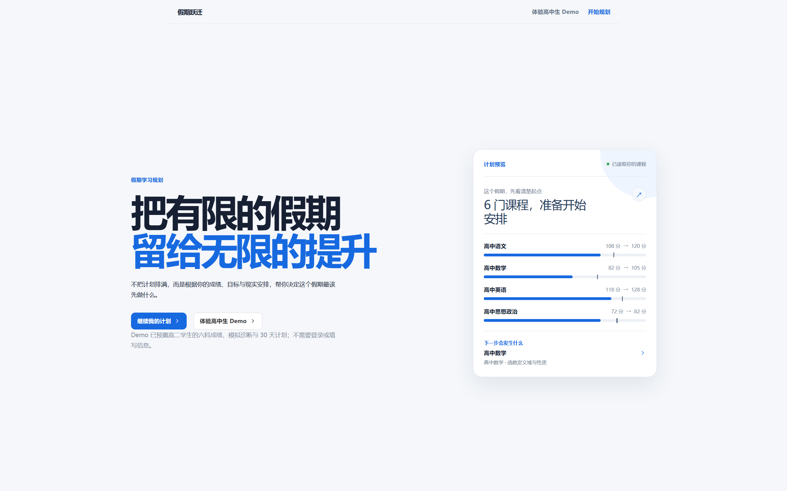
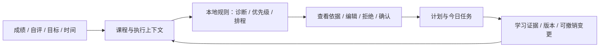
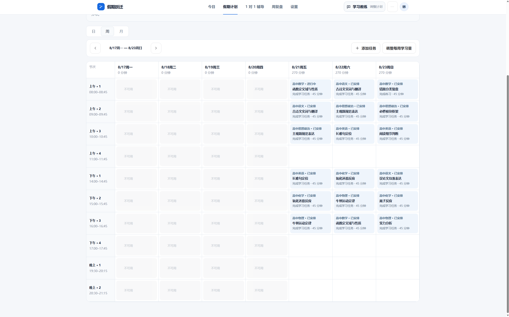

# AI Learning Planner · 假期跃迁

把成绩、目标与有限的假期时间，转成可解释、可执行、能从中断中恢复的学习计划。

[在线演示](https://ai-learning-planner-sepia.vercel.app/) · [体验路径](#三分钟体验) · [本地开发](#本地开发) · [项目文档](#项目文档)



> **当前形态：本地规则驱动的交互 Demo。** 无需 API Key；诊断与计划不是远程模型判断，不承诺成绩或考试结果。

## 从诊断到恢复

面向高中生与大学生，解决多门课程争夺时间、优先级难判断，以及计划被旅行、兼职或未完成任务打断后难以继续的问题。

```text
学习概况 → 课程诊断 → 优先级 → 学习阶段 / Task Pool → 周课表 → 今日执行 → 学习证据 → 周复盘 → 计划恢复
```

| 关键环节 | 设计取舍 |
| --- | --- |
| 先诊断，再排程 | 成绩只是起点证据；展示优势、问题、置信度和限制，避免把低分直接等同于增加任务。 |
| 分开“学什么”与“何时学” | 课程、阶段、Task Pool、Placement 与周课表分层，保留判断到执行的关系。 |
| 先预览，再应用 | 调整展示差异、原因和影响范围，确认后才写入，并生成可撤销的 ChangeSet。 |
| 用执行证据复盘 | 完成、延期与实际学习时长进入后续恢复依据。 |

## 三分钟体验

1. 打开[在线演示](https://ai-learning-planner-sepia.vercel.app/)，点击 **体验高中生 Demo**，载入六门课程、差异化成绩、模拟诊断和 30 天计划。
2. 在 **课程诊断** 中比较数学、英语、物理与政治的结论。
3. 在 **学习计划** 中查看阶段、Task Pool 和周课表，理解安排依据。
4. 在 **今日** 完成或延期任务，记录实际学习分钟数。
5. 到 **周复盘** 查看恢复候选，预览调整后再确认。

示例日程包含数学函数、英语阅读、物理力学与错题整理；具体节次按可用时间和优先级轮换，不是固定承诺。

## 计划如何产生



当前 provider 明确标记本地规则结果。未来接入真实 AI 时，应通过服务端 provider，保留输入、限制、用户确认与回滚边界。

## 界面预览



精选截图见 [`docs/screenshots`](docs/screenshots)。自动化视觉回归截图与对外展示分开维护。

## 技术实现

- React 19、Vite、TypeScript、React Router。
- `localStorage` 本地优先存储，包含 schema 迁移、导出与恢复。
- 诊断、计划、排课、资源、Evidence 与恢复领域分层。
- 任务依据包含成绩差距、优先级、依赖与限制；计划支持草稿、差异预览、启用、版本和撤销。
- 响应式布局、键盘路径与焦点管理，配有 Playwright 测试。

## 本地开发

环境要求：Node.js 22.6+ 与 pnpm。

```bash
corepack enable
pnpm install
pnpm dev
```

访问 Vite 输出的开发地址。检查命令：

```bash
pnpm run lint
pnpm run typecheck
pnpm run test:unit
pnpm run test:e2e
pnpm run build
```

## 项目文档

| 产品与设计 | 实现与验证 |
| --- | --- |
| [案例研究](docs/case-study.md) · [产品故事](docs/product-story.md) | [工程说明](docs/portfolio/engineering-notes.md) |
| [用户流程](docs/user-flow.md) · [设计决策](docs/design-decision.md) | [测试报告](docs/portfolio/test-report.md) |
| [演示脚本](docs/demo-script.md) | |

## 当前边界与隐私

当前 Demo 没有登录、云同步或远程 AI，也没有正式的学习成效验证。后续验证应从可用性测试和长期行为证据开始。

学习数据保存在当前浏览器中。使用真实学生数据前，请阅读应用内隐私页面；不要录入无关敏感信息。
